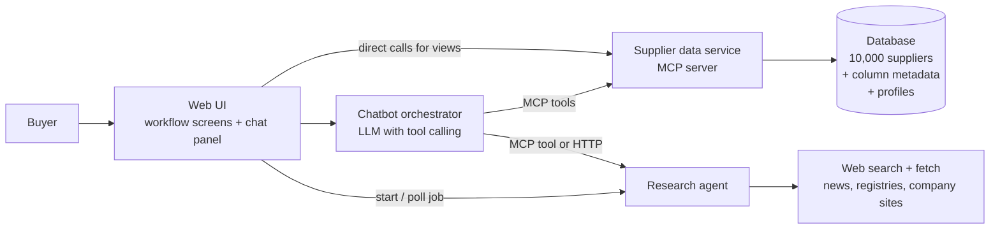

# Smart Supplier Selection: Architecture and Interface Contracts

Kickoff document for the team. It defines the buyer workflow, the system architecture, who owns what, and the JSON contracts between components so that everyone can build in parallel.

> Status: draft for kickoff. Items marked **[DECIDE]** must be agreed by the team before building. Recommendations are given but not final.

---

## 1. Components and ownership

| Component | Owner | Responsibility |
|---|---|---|
| UI + chatbot | UI owner | Workflow screens, comparison views, chat panel, login, deployment, LLM orchestration |
| Supplier data service (MCP server) | Data owner | Database, column metadata, sourcing profiles, all supplier query tools |
| Research agent | Agent owner | Web research on a real company, risk report with sources |
| Evaluation | Data owner | Test questions with computed answers, scoring of chatbot and tools |

Rule: components talk to each other **only** through the contracts in sections 5 and 6. Anyone can build against mock responses (section 8) until the real implementation is ready.

---

## 2. Architecture



Key points:

1. **One data service for both UI and chatbot.** The UI calls the same tools directly to render tables and charts, and the chatbot calls them through MCP. This guarantees the screen and the chat never disagree.
2. **The UI owns workflow state** (selected profile, hard requirements, shortlist of up to 20). It passes that state to the chatbot on every turn (section 7).
3. **The research agent is long-running** (minutes), so it uses a job pattern: start, poll status, fetch result.

### [DECIDE] Technology choices

| Decision | Recommendation | Reason |
|---|---|---|
| Database | DuckDB (file in repo) for the hackathon; Postgres only if needed for users and saved shortlists | Zero setup, reads the CSV directly |
| Data service | Python (FastMCP) exposing MCP over streamable HTTP, plus the same functions as REST for the UI | Same code serves both clients |
| LLM | One provider for chatbot and agent | Simpler keys, cost and debugging |
| UI stack | Owner's choice | Only the contracts matter to others |
| Deployment | One host for UI, one for data service and agent | Must support a jury login |

---

## 3. Buyer workflow

The workflow is the backbone of the UI and of the demo video.

| Step | What the buyer does | UI | Tools used |
|---|---|---|---|
| 1. Define the need | Chooses component category and criticality; optionally delivery country and required certifications | Setup form | `list_profiles` |
| 2. Hard requirements | Sets knock-out rules, for example no Critical quality score, delivery rating at least 90% | Filter panel with live count | `filter_suppliers`, `get_dataset_stats` |
| 3. Weighted ranking | Sees remaining suppliers ranked with the profile weights; can adjust weights | Ranked table with weight sliders | `rank_with_profile` |
| 4. Compare | Picks up to 20 suppliers for the shortlist and compares them | Side-by-side table, radar chart per risk family, Kraljic matrix | `compare_suppliers`, `kraljic_position` |
| 5. Deep dive | Asks why a score is high, looks for alternatives, researches a real company | Supplier detail page, chat, research report view | `explain_supplier`, `find_similar`, `research_company` |
| 6. Decide | Optionally enters quotes, generates a justification memo | Decision view, memo export | `rank_with_profile` (risk-adjusted cost, stretch), chatbot |

Category weighting is part of step 1 (it selects the profile) and is applied in step 3. It is not a separate task type.

The chat panel is available at every step and always knows the current step, profile and shortlist.

---

## 4. Data conventions

### Column names

Source CSV columns are renamed to snake_case when loaded. All tools use these names.

| CSV column | Field name | Type |
|---|---|---|
| supplierID | `supplier_id` | string, e.g. `SUPP_00018` |
| Supplier Name | `supplier_name` | string |
| Total_Risk_Index | `total_risk_index` | int 0 to 100 |
| Industry_Benchmark_Score | `industry_benchmark` | int 0 to 100 |
| Media_Sentiment_Score | `media_sentiment` | int 0 to 100 |
| External_Intelligence_Score | `external_intelligence` | int 0 to 100 |
| Sub_Tier_Visibility_Score | `sub_tier_visibility` | int 0 to 100 |
| Labor_Stability_Score | `labor_stability` | int 0 to 100 |
| Financial_Health_Score | `financial_health` | int 0 to 100 |
| Compliance_Risk_Score | `compliance_risk` | int 0 to 100 |
| Safety_Incident_Score | `safety_incident` | int 0 to 100 |
| Environmental_Exposure_Score | `environmental_exposure` | int 0 to 100 |
| ESG_Performance_Score | `esg_performance` | int 0 to 100 |
| Digital_Security_Score | `digital_security` | int 0 to 100 |
| Operational_Resilience_Score | `operational_resilience` | int 0 to 100 |
| Market_Sentiment_Score | `market_sentiment` | int 0 to 100 |
| Quality_Risk_Score | `quality_risk` | int 0 to 100 |
| Governance_Risk_Score | `governance_risk` | int 0 to 100 |
| Geopolitical_Risk_Score | `geopolitical_risk` | int 0 to 100 |
| Political_Stability_Score | `political_stability` | int 0 to 100 |
| Credit_Rating_Score | `credit_rating` | int 0 to 100 |
| `<Score>_Level` | `<field>_level` | `Low` / `Medium` / `High` / `Critical` |
| Purchase Order Volume (EUR) | `po_volume_eur` | float |
| Order Change Rate | `order_change_rate` | float, percent |
| Supplier Delivery Rating | `delivery_rating` | float, percent |
| Order Confirmation Rate | `order_confirmation_rate` | float, percent |
| Sourcing Risk Level | `sourcing_risk_level` | `Low` / `Medium` / `High` |
| Supply Chain Complexity | `supply_chain_complexity` | `Simple` / `Moderate` / `Complex` |

### Rules every component must respect

- **Direction:** all risk scores and `order_change_rate` mean higher = worse. `delivery_rating` and `order_confirmation_rate` mean **higher = better**. `po_volume_eur` is exposure, not risk.
- **Level bands:** 0 to 24 Low, 25 to 49 Medium, 50 to 74 High, 75 to 100 Critical.
- **Risk families** (for radar charts and grouping): `financial`, `operational_quality`, `compliance_governance`, `external_environment`, `supply_chain_structure`. Mapping comes from `get_metadata`.
- **"Financial risk"** means `financial_health` and `credit_rating` together.
- The dataset has **no price, category, country or region**. These come from buyer input only.
- Supplier names are synthetic and cannot be researched on the web.

---

## 5. Supplier data service: tool contracts

### Common response envelope

Every tool returns the same envelope.

```json
{
  "ok": true,
  "data": {},
  "meta": { "row_count": 3, "truncated": false, "profile_id": "default" },
  "error": null
}
```

On failure:

```json
{
  "ok": false,
  "data": null,
  "meta": {},
  "error": { "code": "UNKNOWN_SUPPLIER", "message": "SUPP_99999 does not exist" }
}
```

Error codes: `UNKNOWN_SUPPLIER`, `UNKNOWN_FIELD`, `UNKNOWN_PROFILE`, `INVALID_FILTER`, `TOO_MANY_SUPPLIERS` (more than 20 in a comparison), `QUERY_REJECTED` (unsafe SQL), `INTERNAL`.

### Shared input type: filter condition

```json
{ "field": "quality_risk_level", "op": "ne", "value": "Critical" }
```

`op` is one of `eq`, `ne`, `lt`, `lte`, `gt`, `gte`, `in`, `not_in`, `between`. Multiple conditions are combined with AND.

### 5.1 `get_metadata`

Returns column descriptions, direction, family, official weight, and level bands. The chatbot system prompt and the UI labels are built from this.

Input: none.

Output `data`:

```json
{
  "fields": [
    {
      "field": "quality_risk",
      "label": "Quality Risk",
      "description": "Risk related to product defects, recalls, or quality management failures.",
      "direction": "higher_is_worse",
      "family": "operational_quality",
      "official_weight": 0.10,
      "type": "score"
    }
  ],
  "level_bands": { "Low": [0, 24], "Medium": [25, 49], "High": [50, 74], "Critical": [75, 100] }
}
```

### 5.2 `list_profiles`

Input: none.

Output `data`:

```json
{
  "profiles": [
    {
      "profile_id": "safety_critical",
      "label": "Safety-critical component",
      "description": "Brakes, bogies, signalling. Quality, safety and compliance weighted highest.",
      "weights": { "quality_risk": 0.25, "safety_incident": 0.15, "compliance_risk": 0.15, "operational_resilience": 0.15, "sub_tier_visibility": 0.10, "delivery_risk": 0.10, "financial_health": 0.05, "governance_risk": 0.05 }
    }
  ]
}
```

Profile ids: `default` (official Total Risk Index weights), `safety_critical`, `strategic_system`, `commodity`, `lksg_due_diligence`. Derived fields usable in weights: `delivery_risk` = 100 - delivery_rating, `confirmation_risk` = 100 - order_confirmation_rate, `change_risk` = order_change_rate rescaled to 0 to 100.

### 5.3 `get_suppliers`

Input:

```json
{ "ids": ["SUPP_00012", "SUPP_00450"], "fields": ["total_risk_index", "financial_health"] }
```

`fields` is optional; default is all fields.

Output `data`: `{ "suppliers": [ { "supplier_id": "SUPP_00012", "supplier_name": "...", "total_risk_index": 47, ... } ] }`

### 5.4 `filter_suppliers`

Input:

```json
{
  "conditions": [
    { "field": "quality_risk_level", "op": "ne", "value": "Critical" },
    { "field": "delivery_rating", "op": "gte", "value": 90 }
  ],
  "sort_by": [{ "field": "total_risk_index", "order": "asc" }],
  "fields": ["supplier_name", "total_risk_index", "delivery_rating"],
  "limit": 50,
  "offset": 0
}
```

Output `data`: `{ "total_matching": 1834, "suppliers": [ ... ] }`

`total_matching` lets the UI show "1,834 suppliers meet your requirements".

### 5.5 `rank_with_profile`

Input (either `ids` or `conditions`, plus a profile or custom weights):

```json
{
  "ids": null,
  "conditions": [{ "field": "quality_risk_level", "op": "ne", "value": "Critical" }],
  "profile_id": "safety_critical",
  "custom_weights": null,
  "limit": 20
}
```

Output `data`:

```json
{
  "profile_id": "safety_critical",
  "ranking": [
    {
      "rank": 1,
      "supplier_id": "SUPP_04211",
      "profile_score": 18.4,
      "total_risk_index": 24,
      "default_rank": 3,
      "rank_change": 2,
      "top_contributors": [{ "field": "quality_risk", "value": 12, "contribution": 3.0 }]
    }
  ]
}
```

`profile_score` uses the same 0 to 100 scale, lower is better. `rank_change` compares with the default profile, which supports the "same suppliers, different profile" demo.

### 5.6 `compare_suppliers`

Input:

```json
{ "ids": ["SUPP_00012", "SUPP_00450", "SUPP_00731"], "fields": null, "profile_id": "default" }
```

Maximum 20 ids. `fields` optional (default: all scores and metrics).

Output `data`:

```json
{
  "suppliers": [ { "supplier_id": "SUPP_00012", "financial_health": 41, "credit_rating": 55 } ],
  "per_field": [
    { "field": "financial_health", "best": "SUPP_00450", "worst": "SUPP_00731", "spread": 38 }
  ],
  "family_scores": [
    { "supplier_id": "SUPP_00012", "financial": 48.0, "operational_quality": 52.3, "compliance_governance": 40.1, "external_environment": 47.0, "supply_chain_structure": 55.0 }
  ],
  "largest_differences": ["financial_health", "quality_risk", "compliance_risk"]
}
```

`best` and `worst` respect each field's direction. `family_scores` feed the radar chart.

### 5.7 `explain_supplier`

Input: `{ "id": "SUPP_00018", "profile_id": "default" }`

Output `data`:

```json
{
  "supplier_id": "SUPP_00018",
  "total_risk_index": 80,
  "total_risk_level": "Critical",
  "percentile": 98.3,
  "dataset_mean": 50.15,
  "contributions": [
    { "field": "operational_resilience", "value": 95, "level": "Critical", "weight": 0.10, "percentile": 98.4, "contribution_vs_mean": 4.5 },
    { "field": "compliance_risk", "value": 98, "level": "Critical", "weight": 0.08, "percentile": 99.0, "contribution_vs_mean": 3.81 }
  ],
  "critical_fields": ["operational_resilience", "compliance_risk", "governance_risk", "safety_incident", "esg_performance", "labor_stability", "geopolitical_risk", "industry_benchmark", "media_sentiment", "market_sentiment", "external_intelligence"],
  "operational_metrics": { "delivery_rating": 76.88, "order_confirmation_rate": 76.18, "order_change_rate": 12.32 }
}
```

`contributions` is sorted by `contribution_vs_mean`, descending. Contribution = weight x (value - dataset mean). All values above are real values for SUPP_00018 (percentile = share of suppliers with a lower value).

### 5.8 `find_similar`

Input:

```json
{
  "id": "SUPP_00450",
  "must_be_lower": ["geopolitical_risk", "environmental_exposure"],
  "conditions": [],
  "limit": 5
}
```

Output `data`: `{ "reference": "SUPP_00450", "similar": [ { "supplier_id": "...", "distance": 12.4, "total_risk_index": 41, "differences": { "geopolitical_risk": -22 } } ] }`

Similarity is Euclidean distance on the 18 risk scores.

### 5.9 `kraljic_position`

Input: `{ "ids": ["SUPP_00012", "SUPP_00450"] }` (`null` for all suppliers, aggregated counts only)

Output `data`:

```json
{
  "thresholds": { "po_volume_eur_high": 1953091 },
  "suppliers": [
    { "supplier_id": "SUPP_00012", "po_volume_eur": 129814.45, "sourcing_risk_level": "High", "quadrant": "bottleneck" }
  ]
}
```

Quadrants: `strategic`, `leverage`, `bottleneck`, `non_critical`. **[DECIDE]** spend threshold (recommendation: 75th percentile, 1.95M EUR) and whether Medium sourcing risk counts as high or low (recommendation: high).

### 5.10 `get_dataset_stats`

Input: `{ "fields": ["total_risk_index"], "conditions": [] }`

Output `data`: `{ "stats": [ { "field": "total_risk_index", "mean": 50.15, "p25": 41, "median": 50, "p75": 59.25, "min": 6, "max": 93, "level_counts": { "Low": 318, "Medium": 4485, "High": 4813, "Critical": 384 } } ] }`

### 5.11 `run_sql` (fallback, chatbot only)

Input: `{ "query": "SELECT ..." }`

Read-only database user, `SELECT` only, maximum 200 rows. Returns `{ "columns": [...], "rows": [...] }`. The UI should not use this tool.

---

## 6. Research agent contract

Research takes minutes, so it is a job.

### 6.1 `research_company` (start)

Input:

```json
{
  "company_name": "Example Rail Components GmbH",
  "country": "DE",
  "website": null,
  "focus": ["financial", "legal", "sanctions", "esg", "operations"],
  "depth": "standard"
}
```

`country`, `website` and `focus` are optional. `depth` is `quick` or `standard`.

Output `data`: `{ "job_id": "res_8f2a", "status": "queued" }`

### 6.2 `get_research_status`

Input: `{ "job_id": "res_8f2a" }`

Output `data`:

```json
{
  "job_id": "res_8f2a",
  "status": "running",
  "progress": [
    { "step": "plan", "message": "Planned 6 research questions" },
    { "step": "search", "message": "Searching insolvency and court records" },
    { "step": "red_flag", "message": "Found a 2025 product recall, digging deeper" }
  ]
}
```

`status` is one of `queued`, `needs_disambiguation`, `running`, `done`, `failed`. The UI shows `progress` live, which makes the agent's work visible in the demo.

When `status` is `needs_disambiguation`, `data.candidates` lists possible entities and the UI asks the buyer to pick one:

```json
{
  "candidates": [
    { "candidate_id": "c1", "legal_name": "...", "country": "DE", "website": "...", "lei": null }
  ]
}
```

The choice is sent back with `confirm_entity`: `{ "job_id": "res_8f2a", "candidate_id": "c1" }`.

### 6.3 `get_research_report`

Input: `{ "job_id": "res_8f2a" }`

Output `data`:

```json
{
  "company": { "legal_name": "...", "country": "DE", "website": "...", "lei": null },
  "summary": "Three to five sentence overview.",
  "overall_assessment": "elevated",
  "risk_flags": [
    {
      "category": "quality",
      "severity": "high",
      "title": "Product recall in 2025",
      "finding": "Short description in the agent's own words.",
      "date": "2025-03-14",
      "sources": [ { "title": "...", "url": "https://...", "publisher": "...", "accessed": "2026-10-18" } ]
    }
  ],
  "category_assessment": [
    { "category": "financial", "assessment": "low", "rationale": "..." }
  ],
  "sources": [ { "title": "...", "url": "https://..." } ],
  "limitations": "What could not be verified."
}
```

`overall_assessment` and severities use `low`, `moderate`, `elevated`, `high`. Categories align with the risk families where possible (`financial`, `legal`, `sanctions`, `quality`, `safety`, `esg`, `operations`, `geopolitical`). Every flag must have at least one source.

---

## 7. Chatbot integration

### Context sent on every turn

The UI sends the workflow state alongside the user's message:

```json
{
  "workflow_step": "compare",
  "profile_id": "safety_critical",
  "hard_requirements": [{ "field": "quality_risk_level", "op": "ne", "value": "Critical" }],
  "shortlist": ["SUPP_00012", "SUPP_00450", "SUPP_00731"],
  "selected_supplier": "SUPP_00450",
  "buyer_inputs": { "category": "Brake components", "delivery_country": "DE", "quotes": null }
}
```

This lets the chatbot resolve "which of these is best?" against the shortlist and profile.

### System prompt must include

- Column metadata from `get_metadata` (descriptions, directions, level bands).
- The rule to answer only from tool results and to cite the values used.
- The rule to state when data is missing (price, country, category) instead of guessing.
- The rule that "financial risk" covers `financial_health` and `credit_rating`.

### [DECIDE] Optional: UI actions from the chatbot

The chatbot may return structured actions alongside its text, so answers can change the UI (for example "add these three to my shortlist"):

```json
{ "ui_actions": [ { "type": "add_to_shortlist", "ids": ["SUPP_00012"] }, { "type": "open_compare" } ] }
```

Action types to agree: `add_to_shortlist`, `remove_from_shortlist`, `set_profile`, `open_supplier`, `open_compare`, `start_research`.

---

## 8. Mocks and parallel work

- The data owner commits `mocks/` with one example response per tool (real values from the dataset) on day one.
- The agent owner commits `mocks/research_report.json` and a sample progress sequence.
- The UI owner builds against the mocks and switches to the real services when available, using one config flag.

---

## 9. Evaluation (data owner)

- Generated test set: question, expected tool, expected answer computed with pandas, answer type.
- Covers all question families plus out-of-scope questions (price, country) where the correct answer is "not in the data".
- Metrics: correct tool chosen, correct final answer.
- The research agent has a separate small manual test set of real companies with known public events.

---

## 10. Kickoff checklist

- [ ] Workflow steps (section 3) agreed
- [ ] Technology choices (section 2) agreed
- [ ] Field names and conventions (section 4) agreed
- [ ] Tool contracts (section 5) agreed
- [ ] Research agent contract (section 6) agreed
- [ ] Chatbot context and UI actions (section 7) agreed
- [ ] Mocks committed by each owner (section 8)
- [ ] Deadline and milestone for the first end-to-end slice set
